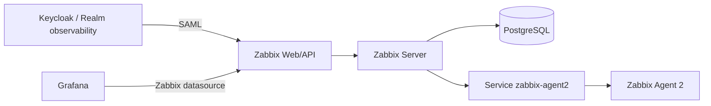

# zabbix-gitops

Stack Zabbix 7.4 para laboratório OpenShift Local: servidor, frontend,
PostgreSQL 16 e Agent 2. O overlay `desenvolvimento` usa réplicas únicas e
recursos reduzidos; não é um desenho de alta disponibilidade.

## Arquitetura



Este repositório entrega a plataforma Zabbix e a autenticação centralizada via
Keycloak. O bootstrap foi mantido deliberadamente simples: ele configura SAML,
certificado IdP e, opcionalmente, o usuário/Secret consumido pelo datasource do
Grafana. Ele não importa templates, não cria hosts, não altera host groups de
monitoramento e não renomeia objetos padrão do Zabbix.

## Pré-requisito

```bash
oc new-project zabbix
oc -n zabbix create secret generic zabbix-db \
  --from-literal=username=zabbix \
  --from-literal=password="$(openssl rand -base64 32)" \
  --from-literal=database=zabbix
oc apply -k overlays/desenvolvimento
```

## Bootstrap SAML e integração Grafana

Após a stack subir, use o mesmo script para obter o certificado público e
cadastrar o IdP/JIT. Não é necessário copiar o certificado nem preencher o IdP
na interface. Dependências locais: Bash, oc, curl, jq, openssl, base64 e Python 3
(biblioteca padrão para interpretar XML). O Python fica no código versionado,
sem comandos de instalação ou scripts embutidos no tutorial.

Exemplo de execução **somente SAML**, a partir de Bash ou Zsh:

```bash
printf '%s' 'Senha atual do administrador local Admin do Zabbix: '
IFS= read -r -s ZABBIX_ADMIN_PASSWORD
printf '\n'
test -n "$ZABBIX_ADMIN_PASSWORD"
```

Se o teste passou, configure o escopo e execute:

```bash
export ZABBIX_ADMIN_PASSWORD
export BOOTSTRAP_CA_FILE=/caminho/para/ingress-ca.crt
export ZABBIX_MANAGE_GRAFANA_DATASOURCE=false
export ZABBIX_ENABLE_SAML_SCIM=false
bash scripts/bootstrap-zabbix.sh
```

O arquivo indicado é a **CA pública HTTPS** das Routes, diferente do certificado
de assinatura SAML que o script consulta automaticamente. Com certificados
confiáveis pelo sistema, a variável pode ser omitida. O script exige HTTPS
validado e não usa `curl -k`. Usa a senha atual do administrador **local do
Zabbix**, não a senha de `zabbix-admin` no Keycloak nem a senha do banco.

Após sucesso:

```bash
unset ZABBIX_ADMIN_PASSWORD BOOTSTRAP_CA_FILE
unset ZABBIX_MANAGE_GRAFANA_DATASOURCE ZABBIX_ENABLE_SAML_SCIM
```

Não grave senhas no Git nem execute com `set -x`. O arquivo `.env` é opcional;
variáveis já fornecidas no ambiente prevalecem sobre ele. Caso utilize `.env`,
mantenha-o privado e fora do Git. O modo acima não altera a conta técnica ou o
Secret do Grafana. A integração opcional do datasource exige revisão própria;
sua opção padrão no script continua `true` para compatibilidade com o fluxo
completo existente.

O script faz:

- autentica na API do Zabbix sem imprimir credenciais;
- habilita SAML no Zabbix 7.4 apontando para o realm `observability` do
  Keycloak;
- extrai o certificado público SAML do metadata do Keycloak e cria/atualiza o
  ConfigMap `zabbix-saml-idp` com a chave `idp.crt`;
- habilita JIT provisioning SAML, usando atributos `username`, `firstName`,
  `lastName` e `groups`;
- habilita SCIM no diretório SAML quando `ZABBIX_ENABLE_SAML_SCIM=true`;
- mapeia grupos Keycloak para grupos/roles Zabbix;
- opcionalmente cria/atualiza o usuário técnico `grafana-datasource` e o Secret
  `grafana/zabbix-datasource`, quando `ZABBIX_MANAGE_GRAFANA_DATASOURCE=true`.

O script não provisiona hosts, templates, web scenarios, macros Kubernetes ou
inventário de monitoramento. Esses objetos devem ser configurados manualmente no
Zabbix ou por um processo dedicado, quando houver um desenho de monitoramento
mais maduro.

## Secrets

| Secret | Namespace | Chaves | Consumidor |
|---|---|---|---|
| `zabbix-db` | `zabbix` | `username`, `password`, `database` | PostgreSQL, Zabbix Server e Zabbix Web |
| `zabbix-datasource` | `grafana` | `username`, `password` | Grafana datasource Zabbix |

## ConfigMaps

| ConfigMap | Namespace | Chave | Consumidor |
|---|---|---|---|
| `zabbix-saml-idp` | `zabbix` | `idp.crt` | Zabbix Web SAML |

Criação/rotação do banco:

```bash
oc -n zabbix create secret generic zabbix-db \
  --from-literal=username=zabbix \
  --from-literal=password="${ZABBIX_DB_PASSWORD}" \
  --from-literal=database=zabbix \
  --dry-run=client -o yaml | oc apply --server-side -f -
```

Rotação do usuário técnico do Grafana:

```bash
ZABBIX_GRAFANA_PASSWORD="$(openssl rand -base64 36)" scripts/bootstrap-zabbix.sh
```

Rotação do certificado IdP SAML: rotacione a chave/certificado no Keycloak e
reexecute `scripts/bootstrap-zabbix.sh`. O script compara o conteúdo de
`idp.crt`, atualiza o ConfigMap e reinicia `deployment/zabbix-web` quando
`ZABBIX_RESTART_WEB_ON_IDP_CERT_CHANGE=true`.

## SSO via Keycloak

O Zabbix 7.4 suporta SAML para SSO. O script configura:

- IdP Entity ID: `${KEYCLOAK_BASE_URL}/realms/observability`;
- SSO/SLO URL: `${KEYCLOAK_BASE_URL}/realms/observability/protocol/saml`;
- SP Entity ID: `zabbix`;
- ACS: `${ZABBIX_BASE_URL}/index_sso.php?acs`.

O client SAML correspondente é mantido em `keycloak-gitops`.

O deployment `zabbix-web` monta `/etc/zabbix/web/certs/idp.crt` e define:

```text
ZBX_SSO_IDP_CERT=/etc/zabbix/web/certs/idp.crt
ZBX_SSO_SETTINGS={"baseurl":"<URL pública do Zabbix>","use_proxy_headers":true,"strict":true}
```

`use_proxy_headers` é necessário porque a Route do OpenShift termina TLS na
borda e encaminha a requisição HTTP para o container.

## JIT provisioning

O bootstrap configura JIT com os mappers SAML provisionados pelo
`keycloak-gitops`:

| Atributo SAML | Variável | Uso no Zabbix |
|---|---|---|
| `username` | `ZABBIX_SAML_LOGIN_ATTRIBUTE` | login/alias do usuário |
| `firstName` | `ZABBIX_SAML_FIRST_NAME_ATTRIBUTE` | nome |
| `lastName` | `ZABBIX_SAML_LAST_NAME_ATTRIBUTE` | sobrenome |
| `groups` | `ZABBIX_SAML_GROUP_ATTRIBUTE` | mapeamento de grupos |

Mapeamentos criados:

| Grupo Keycloak | Grupo Zabbix | Role |
|---|---|---|
| `zabbix-super-admins` | `Zabbix administrators` | `Super admin role` |
| `zabbix-admins` | `Zabbix administrators` | `Super admin role` |
| `zabbix-users` | `Grafana datasource readers` | `User role` |
| `zabbix-guests` | `Grafana datasource readers` | `User role` |

O grupo `Disabled provisioned users` é criado com `users_status=disabled` e
configurado em `disabled_usrgrpid`, permitindo desabilitar usuários
deprovisionados pelo IdP.

O client SAML do Keycloak emite o atributo `groups` sem caminho completo, por
isso os padrões acima não usam a barra inicial. As opções de assinatura ficam
conservadoras: o Zabbix valida assertions assinadas pelo IdP, mas não exige
criptografia nem assinatura de AuthN/logout requests enquanto não houver
certificado/chave de SP provisionados no frontend.

SCIM permanece desabilitado por padrão. Habilite somente com endpoint e cliente
SCIM configurados; JIT no login não comprova funcionamento de SCIM.

## Datasource Grafana

Quando `ZABBIX_MANAGE_GRAFANA_DATASOURCE=true`, o bootstrap cria/atualiza:

- usuário `grafana-datasource`;
- grupo `Grafana datasource readers`;
- Secret `grafana/zabbix-datasource` com `username` e `password`.

Por padrão, o script não cria host groups de monitoramento e não concede leitura
a nenhum host group inexistente. Se você já tiver host groups manuais no Zabbix e
quiser liberar leitura para o datasource, informe:

```bash
ZABBIX_GRAFANA_READ_HOST_GROUPS="Linux servers,Templates"
scripts/bootstrap-zabbix.sh
```

## Validação

```bash
oc -n zabbix get pods,svc,route
oc -n zabbix get configmap zabbix-saml-idp
oc -n grafana get secret zabbix-datasource
curl -k "$(oc -n zabbix get route zabbix -o jsonpath='https://{.spec.host}')/api_jsonrpc.php"
```

## Ambientes

```bash
oc kustomize overlays/desenvolvimento >/tmp/zabbix-dev.yaml
oc kustomize overlays/aceite >/tmp/zabbix-aceite.yaml
oc kustomize overlays/producao >/tmp/zabbix-prod.yaml
oc apply --dry-run=client -k overlays/desenvolvimento
```

O Route da base não fixa host; OpenShift gera o domínio por cluster. Como SAML
exige `baseurl` estável, cada overlay define `ZBX_SSO_SETTINGS` com a URL
pública esperada do ambiente. Ajuste esse valor junto com o domínio real antes
de promover para aceite/produção. O script de bootstrap descobre Zabbix e
Keycloak por Route quando URLs não são informadas no `.env`.

Referências:

- https://www.zabbix.com/documentation/7.4/en/manual/installation/containers
- https://www.zabbix.com/documentation/7.4/en/manual/web_interface/frontend_sections/users/authentication/saml
- https://www.zabbix.com/documentation/7.4/en/manual/api/reference/userdirectory/create

## Aprender a configuração

Consulte o [guia comentado](docs/APRENDIZADO.md) para entender componentes, escolhas, testes positivos/negativos e reversão.

## Seleção e rotação do certificado SAML

O helper `scripts/extract-saml-signing-cert.py` interpreta namespaces XML e
seleciona somente certificados em `IDPSSODescriptor/KeyDescriptor use="signing"`.
Confere o EntityID do realm, formato X.509, expiração e chave RSA. Entradas de
criptografia são ignoradas. O transporte HTTPS valida a origem do metadata;
o helper não verifica uma assinatura XML do documento.

Com múltiplos certificados de assinatura distintos, o script interrompe antes
de atualizar o ConfigMap. Durante rotação, confira a chave ativa no Keycloak e
informe sua impressão digital SHA-256 em `KEYCLOAK_SAML_CERT_SHA256`. A impressão
digital precisa corresponder a um certificado publicado como assinatura; não
há seleção automática pelo último elemento ou pela data de expiração.

O bootstrap autentica e verifica o diretório existente antes de publicar o
certificado. Outro EntityID ou múltiplos diretórios exigem revisão. Ao mudar o
certificado, atualiza o ConfigMap e aguarda o rollout do frontend; as sessões
podem ser interrompidas. Não há transação única entre Kubernetes e a API Zabbix:
se uma etapa posterior falhar, investigue e reexecute depois de corrigir a causa.
A reexecução reaproveita o diretório existente do mesmo IdP e não reinicia o
frontend quando o certificado não mudou. Reconciliar o diretório pode substituir
mapeamentos personalizados: revise a política antes da execução.

Os cenários sintéticos estão em `tests/test-saml-bootstrap.py`, executados no CI.
Eles não comprovam login SAML real, permissões Kubernetes, rollout ou JIT em um
cluster. Após o bootstrap, teste login permitido, papel recebido, logout e usuário
sem mapeamento. Mantenha um administrador local para recuperação.
